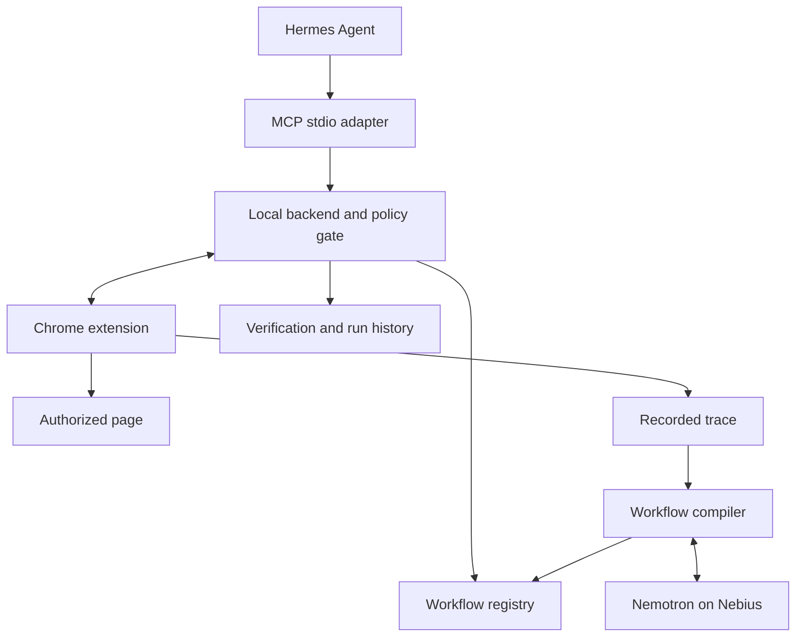

# Browser Workflow MCP End to End Agent Build Specification

Version 2.0 | One builder | One coding agent session | 48 hour delivery window

## How to use this document

Attach this entire Markdown file to Devin, Claude Code, or Codex in the target repository. Send: "Implement this specification end to end. Start now, work through the milestones, and keep BUILD_STATUS.md current."

Everything below is addressed directly to the implementing coding agent. The human handles credentials, browser permission dialogs, and final submission. All implementation, integration, documentation and checks belong to you. No three founder coordination is required. This file is a self contained implementation brief; do not require earlier chat context or the prior build plan.

## 1 Execution mandate

You are the sole implementation owner. Build a runnable local platform, not an architecture proposal or disconnected mockups. Complete the browser recorder, workflow compiler, executor, registry, MCP integration, assistant interface, dashboard and demo portal as one working product. Work sequentially through the milestones and verify the actual browser path before adding features.

Inspect the repository and applicable AGENTS.md instructions first. Preserve existing user work. If the repository is empty, scaffold the structure specified here. Choose reasonable implementation details yourself. Ask only when blocked by credentials, required account access, or a consequential ambiguity that cannot be resolved from the repository. Do not request approval for routine implementation decisions already authorized by this build request.

Do not stop after scaffolding, a plan, passing mocked tests, or the first working component. Continue until the release checks pass or a concrete external blocker prevents further work. If externally blocked, finish all independent work and report the exact remaining action. Do not claim a live integration passed without running it.

Maintain BUILD_STATUS.md from the first milestone. Record completed milestones, current commands, test results, actual package and model versions, blockers, and the next exact action. At a context boundary, continue from that file. Keep commits coherent if the repository permits commits. Never push, deploy externally, send messages, or submit the entry unless separately authorized.

## 2 Product contract and deadline scope

Build a local first personal assistant that learns browser procedures from an explicit demonstration. The user records a task, marks variable inputs and result fields, compiles it with NVIDIA Nemotron, validates it on another input, and gains an MCP tool. Later calls execute the stored procedure against fresh page data with independent success checks.

Working product name: BrowserSkills. Use one Chrome demo profile with one dedicated execution tab. The core launch experience is Dashboard → Teach → Compile → Validate → Run or Ask assistant → Inspect evidence.

### Required working release

- Real Manifest V3 extension captures interactions and executes browser actions.
- User can parameterize captured inputs and select output fields from the page.
- Real NVIDIA Nemotron inference compiles the trace into a constrained workflow.
- SQLite stores candidates, validated versions, runs and minimal procedural memory.
- Deterministic executor performs live page actions, checks output identity, and reports verified results or useful errors.
- MCP exposes validated workflows and an actual protocol client invokes them.
- Hermes can connect to that MCP server using a generated and tested configuration when its runtime is available.
- Dashboard includes a working natural language assistant using Nemotron tool calling over the same MCP interface, so the core product remains usable without a separately installed Hermes UI.
- Controlled demo portal supports three read workflows and changing data.
- Setup, test, reset, doctor and demo commands work as documented.

### Integration targets and explicit release limits

Use Nemotron on Nebius as the default model path. Implement Hermes integration and smoke test it if installation is possible. Attempt OpenShell and a current compatible NemoClaw or community blueprint after the core browser loop passes. Timebox sandbox setup to 90 minutes. Keep its status explicit and do not make it a hard prerequisite for running the app.

The full hackathon platform means the complete supported local experience, not all possible websites. Defer multiuser accounts, cloud hosting, arbitrary code generation, automatic API discovery, workflow sharing, purchases, downloads, arbitrary writes and unattended authentication. Keep all three demo workflows read only. One complete browser workflow takes precedence over a broad mock platform.

If model credentials are missing, provide a clearly labeled deterministic fixture compiler for development, complete the live adapter and all other components, then report the missing credential. Fixture mode must never silently replace live inference or satisfy the live release criterion.

Do not claim a fully private hosted inference path: redacted task context leaves the device. Cookies and secrets remain local. The connected execution device must be awake; scheduled browser jobs cannot run on a sleeping laptop.

## 3 Stack and deployment decisions

| Layer | Choice | Reason and limit |
| --- | --- | --- |
| Browser | Chrome Manifest V3 extension, TypeScript | Same browser records and executes; use ordinary content scripts |
| Local backend | Node.js LTS, TypeScript, Zod | Shared runtime schemas across compiler, bridge and executor |
| Browser bridge | Extension initiated authenticated WebSocket to loopback backend | Faster hackathon setup than packaging native messaging |
| Data | SQLite and a local artifacts directory | Transactions, simple persistence, no cloud database dependency |
| MCP | Official TypeScript SDK, local stdio entry point | Hermes launches the adapter; avoid exposing a remote MCP endpoint |
| Agent | Hermes configured with your MCP adapter and Nemotron provider | Existing memory, tool calling and scheduling capabilities |
| Inference | NVIDIA Nemotron through Nebius Token Factory | Confirm a currently available tool capable model in the first hour |
| Runtime isolation | OpenShell with a compatible NemoClaw or community blueprint | Optional deadline lane; compatibility and host requirements must pass a smoke test |
| Dashboard and portal | React dashboard, integrated assistant and local web portal | Prioritize a usable recording and run flow |

Pin exact package versions and the exact model ID once the smoke tests pass. Do not copy an unverified model ID or sandbox command from an old example. Set NEBIUS_BASE_URL, NEBIUS_API_KEY and NEMOTRON_MODEL in local configuration; never commit real keys.

NVIDIA documents a Hermes plus NemoClaw and OpenShell example, but this does not establish that every current release works together. Budget 90 minutes for the sandbox proof. If it fails, run the local core and accurately describe sandbox integration as incomplete.

## 4 System boundaries



Backend is the sole authority for workflow versions, runs and policy. Extension only accepts constrained operations from its paired backend. The MCP adapter delegates to the backend; it does not open a second database writer or execute arbitrary model code. Hermes chooses tools, but cannot bypass executor checks.

Default endpoints: dashboard and authenticated backend HTTP on 127.0.0.1:4317; authenticated extension WebSocket upgrade at /bridge; controlled portal on 127.0.0.1:4318. Ports are proposed defaults, configurable together. Never bind the demo backend to all interfaces.

For OpenShell, allow only the configured inference destination and an explicit bridge route. Loopback inside a sandbox is not host loopback. Test host routing, authentication and policy before the demo. Keep the real browser outside the sandbox and enforce action authorization in the local backend independently.

## 5 Shared data contract

Create packages/contracts first. Export Zod schemas and inferred TypeScript types. Implement the examples below as executable runtime validated contracts. Extend them consistently where the UI and endpoints require additional fields; do not leave incompatible copies in different packages.

```ts
type Locator = {
  role?: 'button' | 'link' | 'textbox' | 'combobox';
  name?: string;
  label?: string;
  testId?: string;
  css?: string;
};
type Value = { literal: string } | { parameter: string };
type Step =
  | { id: string; op: 'navigate'; url: Value }
  | { id: string; op: 'fill'; target: Locator; value: Value }
  | { id: string; op: 'click'; target: Locator }
  | { id: string; op: 'select'; target: Locator; value: Value }
  | { id: string; op: 'waitFor'; target: Locator; timeoutMs: number }
  | { id: string; op: 'extract'; target: Locator; outputKey: string };
type Workflow = {
  schemaVersion: 1;
  id: string;
  version: number;
  name: string;
  description: string;
  profileId: string;
  allowedOrigins: string[];
  effect: 'read' | 'write';
  parameters: Record<string, { type: 'string'; description: string }>;
  steps: Step[];
  successChecks: Array<
    | { kind: 'outputPresent'; key: string }
    | { kind: 'outputEqualsParameter'; key: string; parameter: string }
  >;
  status: 'candidate' | 'validated' | 'disabled';
};
```

Runtime parameter validation requires every declared parameter, rejects undeclared parameters, and limits lengths. For the MVP, all inputs are strings. Add richer JSON Schema only after integration works.

Trace events contain traceId, sequence, timestamp, page URL without secrets, frame ID, event type, locator candidates, input value reference and bounded DOM context. At stop, the user explicitly chooses the result element or result fields. This avoids guessing the success condition solely from clicks.

Trace input values are temporary local examples. The teach UI lets the user mark fields as parameters and name them. Before inference, replace example values with parameter placeholders where possible. Password, payment and secret fields are never recorded. Raw traces expire after the demo session unless the user chooses to retain them.

Sample first workflow:

```json
{
  "schemaVersion": 1,
  "id": "portal_lookup_order",
  "version": 1,
  "name": "portal_lookup_order",
  "description": "Look up an order and return its current status",
  "profileId": "demo-personal",
  "allowedOrigins": ["http://127.0.0.1:4318"],
  "effect": "read",
  "parameters": {
    "order_id": {"type": "string", "description": "Order identifier"}
  },
  "steps": [
    {"id": "s1", "op": "navigate", "url": {"literal": "http://127.0.0.1:4318/orders"}},
    {"id": "s2", "op": "fill", "target": {"label": "Order ID"}, "value": {"parameter": "order_id"}},
    {"id": "s3", "op": "click", "target": {"role": "button", "name": "Search"}},
    {"id": "s4", "op": "waitFor", "target": {"testId": "order-result"}, "timeoutMs": 8000},
    {"id": "s5", "op": "extract", "target": {"testId": "result-order-id"}, "outputKey": "order_id"},
    {"id": "s6", "op": "extract", "target": {"testId": "order-status"}, "outputKey": "status"}
  ],
  "successChecks": [
    {"kind": "outputEqualsParameter", "key": "order_id", "parameter": "order_id"},
    {"kind": "outputPresent", "key": "status"}
  ],
  "status": "candidate"
}
```

Use portal_lookup_order as the mandatory first vertical slice. Add portal_list_invoices with a customer parameter and portal_lookup_ticket with a ticket parameter only after this passes end to end. Keep all three read only. File downloads require a downloads permission, event correlation and file checks, so defer them unless spare time remains.

## 6 Browser recording and execution

Recorder listens for user initiated click, change, input and navigation events. Coalesce typing into one fill action and omit irrelevant mouse movements. Preserve event order across page loads by persisting the active recording ID and sequence in extension storage. For an MVP, support top level DOM pages; detect and reject unsupported iframes, canvas controls and closed shadow roots.

Manifest permissions should cover storage, tabs and scripting plus the explicit demo origins. Avoid all-site permission. Exclude authentication pages from traces. Service worker reconnection must not reissue already acknowledged browser actions.

The extension initiates the bridge connection with a random installation pairing token entered during setup. Backend validates the token and extension origin, rejects page origins, caps message sizes and never logs the token. HTTP mutations also require authorization and trusted Origin checks. Do not embed a shared token in the repository or transmit it in a URL query string.

Bridge messages:

```ts
type Command = {
  commandId: string; runId: string; stepId: string;
  profileId: string; tabId: number;
  allowedOrigins: string[]; step: Step;
};
type Reply = {
  commandId: string;
  status: 'ok' | 'error';
  errorCode?: string;
  output?: Record<string, string>;
  currentUrl: string;
};
```

Transport validates schemas on both sides. Command values are bound by backend before execution. Keep a short completed-command ledger to deduplicate reconnects. Backend retains the durable run checkpoint. If connection loss makes a click outcome uncertain, stop and inspect current state; do not automatically replay the click.

Locators must resolve to exactly one visible, enabled target. Prefer label and accessible role/name, then test ID, then recorded CSS. Content scripts do not provide Playwright locators automatically: implement and test the small supported resolver for the portal, or use CSS/test IDs as the supported MVP path. Ambiguous matches return LOCATOR_AMBIGUOUS.

Use condition based waits rather than fixed sleeps. Navigate via the extension tabs API, await page readiness, then resolve the next step. Validate origin before every action and on redirects. Only permit http or https navigation to explicit origins. Reject javascript URLs, arbitrary evaluate operations and model generated JavaScript.

## 7 Compiler and workflow promotion

Compiler input: redacted trace, user task description, marked parameters, selected outputs, allowed action vocabulary, and schema. Nemotron returns one JSON workflow. Parse, validate with Zod, and apply independent policy checks. Never execute model output directly.

Reject unknown operations, unbound parameters, extra origins, secret references, missing success checks, and unsafe navigation. Allow one structured correction request for malformed output, then surface COMPILE_FAILED with a useful reason. Persist the model ID, prompt version and compilation latency without raw sensitive context.

Validation is an explicit dry run against a second known portal record. For read only workflows this may perform normal reads. Verify that output order_id equals the new input and status is present; check fixture expected values during development. Only then transition candidate to validated. One trace proves the observed path, not arbitrary branches or general reliability.

An optional repair produces version N+1 in candidate state. Replay and verify before replacing the active version. Keep N for rollback. A layout demo may change a CSS class while retaining accessible labels, demonstrating fallback first; use model repair only when fallback actually fails.

## 8 MCP and backend API contract

Backend HTTP interface, all private and authenticated:

| Route | Request | Response |
| --- | --- | --- |
| GET /health | None | Backend, browser, model connectivity status |
| POST /traces | Task and profile | traceId |
| POST /traces/:id/stop | Parameters and selected outputs | Stored trace status |
| POST /workflows/compile | traceId | Candidate workflow or compile error |
| POST /workflows/:id/validate | version and test arguments | Validation run result |
| GET /workflows | None | Workflow summaries and active versions |
| POST /runs | workflowId, version, arguments, requestId | runId |
| GET /runs/:id | None | Status, outputs, checks, timing and errors |

POST /runs deduplicates requestId within workflow and profile. Backend snapshots the selected version for the run. A second run on the locked execution tab returns BUSY; do not silently queue beyond the demo deadline. Reusing a requestId with different arguments returns a conflict instead of returning an unrelated prior result.

MCP exposes one named tool per validated workflow with generated input schema. For deadline simplicity, restart the MCP adapter after promotion so tools/list reflects the registry snapshot. In the live demo, teach and validate first, reconnect Hermes, then invoke the new tool. Dynamic tool list notifications are stretch.

tools/call creates a backend run, polls within a bounded timeout, and returns structured output plus readable text. Return isError for failed executions with the run ID and actionable error. If MCP times out or disconnects, request run cancellation, stop at the next step boundary, and preserve whether any side effect already occurred.

```json
{
  "runId": "run_042",
  "workflowId": "portal_lookup_order",
  "workflowVersion": 1,
  "status": "success",
  "outputs": {"order_id": "B204", "status": "Shipped"},
  "verification": {"passed": true, "checksPassed": 2, "checksTotal": 2},
  "executionMode": "cached_dom",
  "modelCallsDuringExecution": 0,
  "durationMs": 1840
}
```

Numbers above are illustrative fixture values, not benchmark claims. A compiler model call is separately counted and must not be hidden in performance reporting.

## 9 Storage and state machines

SQLite tables: traces(id, profile_id, redacted_json, created_at); workflows(id, version, status, definition_json, created_at, unique(id, version)); active_versions(workflow_id, version); runs(id, request_id, workflow_id, version, profile_id, status, outputs_json, verification_json, started_at, finished_at); run_steps(run_id, step_id, command_id, status, evidence_json).

Workflow lifecycle: candidate to validated to disabled. Promotion updates active_versions in one transaction. A failed repair leaves the prior active version intact.

Run lifecycle: queued to running to verifying to success. Persist interrupted as an explicit terminal status for restart recovery. running may end in needs_login, needs_review, failed or cancelled; verifying may end in failed. Return status success only after all checks pass. On backend restart, mark unfinished runs interrupted and require state inspection before retry.

Error codes: BROWSER_OFFLINE, PROFILE_MISMATCH, ORIGIN_DENIED, NEEDS_LOGIN, LOCATOR_NOT_FOUND, LOCATOR_AMBIGUOUS, STEP_TIMEOUT, UNSUPPORTED_PAGE, VERIFICATION_FAILED, MODEL_UNAVAILABLE, COMPILE_FAILED, BUSY and INTERRUPTED.

Use one dedicated execution tab. Cookies remain in its browser profile. Backend and model never need exported browser cookies. The laptop and browser must remain awake for browser tasks; describe the system as always available while the connected execution device is online, not as able to operate a sleeping laptop.

## 10 Privacy and action authorization

Local storage does not make hosted inference fully private. Nebius receives the redacted context sent to its model endpoint. Show that boundary in setup and the pitch. Keep full DOM snapshots out of requests; send bounded relevant subtrees with secrets removed. Self hosted Nemotron is a later deployment mode unless already available.

Classify effects from a local reviewed policy, not the model description. Search buttons may be read actions, but forms that submit changes are writes. For the MVP, tools are read only and the allowed portal routes are reviewed. Future writes require approval bound to exact workflow version, arguments and action. A sandbox network allowlist does not restrict what an outside browser can do through a privileged bridge.

Treat page text as data. Instructions embedded in a page cannot add tools, change allowed origins, request credentials or alter permissions. Store no raw tokens in runs. Record only the evidence needed to diagnose a failure.

## 11 Required implementation choices

Use npm workspaces with TypeScript, React and Vite, a Fastify HTTP backend with a compatible WebSocket plugin, Zod, SQLite, and the official MCP TypeScript SDK. Prefer a single backend process with in process compiler and executor packages. Use better-sqlite3 if compatible with the installed Node release; otherwise select a maintained SQLite binding and record the reason. Pin dependencies and commit the lockfile. Read current official SDK documentation before using version dependent APIs.

Build dashboard assets with Vite. In development, serve the dashboard on 127.0.0.1:4316 and proxy authenticated API requests to backend 4317. Production local startup serves built dashboard assets from backend 4317. Demo portal remains 4318. Allow only these exact configured dashboard origins; do not use wildcard CORS. The HTTP endpoints listed earlier are backend routes. Prefix with /api only if consistently reflected in the contracts, clients and docs.

### Repository structure

```text
apps/extension/           Manifest, popup, service worker, content script
apps/dashboard/           Teach wizard, skills, assistant and run history
apps/demo-portal/         Seeded local orders, invoices and support tickets
services/backend/        HTTP, WebSocket, auth, run orchestration and DB
services/mcp/            Stdio adapter with tool registration and errors
packages/contracts/      Runtime schemas and shared TypeScript types
packages/compiler/       Nemotron provider, redaction and plan compilation
packages/executor/       Policy, run state machine and command dispatch
packages/agent/          Nemotron tool loop and real MCP client
fixtures/                Redacted traces, candidate plans and expected data
scripts/                 Doctor, reset, smoke, demo and optional setup
infra/                   Verified sandbox configs or explicit templates
docs/                    Setup, architecture, demo, limitations and evidence
BUILD_STATUS.md          Current progress and reproducible continuation
```

Keep the SQLite database and generated tokens in a gitignored local data directory. Include migrations with schema versioning, indexes and foreign keys. Add unique constraints for workflow versions and request deduplication. Store timestamps in UTC. Generate install tokens with a cryptographically secure RNG.

### Environment contract

Provide .env.example with documented placeholders:

```dotenv
APP_HOST=127.0.0.1
DASHBOARD_PORT=4316
BACKEND_PORT=4317
PORTAL_PORT=4318
DATA_DIR=./data
MODEL_MODE=live
NEBIUS_BASE_URL=
NEBIUS_API_KEY=
NEMOTRON_MODEL=
ALLOWED_SITE_ORIGINS=http://127.0.0.1:4318
```

Resolve paths relative to repository root regardless of caller working directory. Never print API keys in doctor output. If the provider supports listing models, use it for configuration discovery; otherwise document selection from the official catalog. Do not silently choose a non NVIDIA model. Request timeouts, one bounded retry for transient inference failures, and structured provider errors are required. Verify actual tool calling support for the chosen model, not just plain text completion.

### Extension lifecycle details

Backend assigns trace event sequence numbers after ingestion. Extension events include a stable event UUID and local ordering metadata; deduplicate on event UUID so reconnect cannot duplicate fills or clicks. The service worker owns pairing, connection and active recording metadata. Content scripts buffer briefly during reconnect and never record password input or authentication forms. Do not rely on indefinitely alive service worker memory.

Record start URL and captured navigation transitions. Coalesce typing before a click and flush pending input before recording that click. Record initial input state when a value was prefilled. An output picker uses a visible hover outline and click selection; prevent the selection click from activating the page control. Save a locator, output key, sample text and bounded context. A user can cancel picking and recording.

For parameter marking, list captured fills in the Teach wizard; the user selects the variable fields and provides names. Suggest names from labels but require the resulting mapping to be explicit before compilation. Persist output declarations separately from the workflow until compilation succeeds. The compiler may combine recorded events but cannot invent a domain or expand the permitted action set.

Implement visible DOM target resolution using associated labels, supported native roles and explicit aria roles and names. State the exact supported subset in docs; do not pretend it is a full accessibility tree. A locator succeeds only when its highest priority matching strategy has one valid target. More than one valid target is an error, not permission to use a less specific fallback to guess.

For fill operations, use the appropriate native value setter and dispatch bubbling input and change events so React controlled fields update. Click only visible enabled elements. Extraction uses rendered text, or value for supported form controls. Waiting uses MutationObserver plus a bounded timer. URLs are parsed with the URL API, normalized and checked against exact allowed origins on both sides of the bridge. Strip sensitive query parameters from traces without breaking the local portal routes.

Use an explicit supported-page check for the active top level document. Cross origin frames and invisible targets fail clearly. For an extension inaccessible page, explain the required manual navigation instead of hanging.

### Browser identity and authorization

Generate a stable extension installation ID and register it as the demo profile when pairing. This is an installation binding, not proof of a website account identity. For the controlled portal, verify a displayed signed-in account indicator before execution; restrict demo portal actions by a local reviewed policy. New website origins require explicit user opt-in and a reviewed action policy before execution. Do not assume any arbitrary click becomes safe because a model labels it read only.

Handshake accepts a token in the first WebSocket message, with a short unauthenticated timeout. Authenticate before processing commands. Reject unexpected Origin headers and require the configured extension ID; scripts may spoof headers, so origin checks supplement token authentication rather than replace it. Require authenticated loopback HTTP access, trusted dashboard origins and CSRF protection appropriate to the chosen session mechanism. Configure a simple setup screen or one time code to establish the dashboard session without putting tokens in URLs. Never serve secrets in frontend build variables.

## 12 Dashboard and assistant behavior

Build a coherent desktop UI with a left navigation rail, legible typography, one primary accent, keyboard focus states and clear loading and empty states. Every visible control must work or explain its unavailable prerequisite. Avoid fabricated activity, fake metrics and unused controls.

| Screen | Required interactions |
| --- | --- |
| Overview | Browser, model and MCP health; teach action; recent runs |
| Teach | Task name; target tab; start, stop, cancel; mark parameters; select outputs; compile; review candidate; validate with new arguments |
| Skills | List status and versions; inspect steps and schemas; run; disable; show publication or reconnect status |
| Assistant | Natural language requests; selected model; tool call arguments; run links; verified output; actionable failures |
| Runs | Ordered steps, output checks, duration, source input, workflow version, errors and retry action |
| Settings | Pair browser; allowed origins; provider readiness; explicit fixture mode; external integration status |

Implement backend endpoints needed by these screens in addition to the earlier contract: trace event ingestion and lookup; candidate detail; workflow disabling; active tab selection; run cancellation; assistant request and status. Return consistent schema validated JSON errors with code, message and optional runId. Return 401 or 403 for authentication failures, 409 for conflicts and 422 for invalid inputs. Never return provider error blobs containing credentials.

The built in assistant must use packages/agent with a real MCP client subprocess, not call executor internals. On each new user request, refresh tools by reconnecting if the registry revision changed. Convert discovered MCP tools into the model provider's function definitions. Invoke only discovered tool names, parse arguments against schemas, append tool results and allow at most five tool rounds. A successful reply includes actual output and its run link; a failed run cannot be summarized as completed.

Backend launches this client using a resolved absolute executable and arguments, avoiding shell string interpolation. The child MCP adapter authenticates to the already running backend. Avoid boot loops: MCP startup must not launch backend or agent. Send MCP server diagnostics to stderr; stdout contains only protocol traffic. Close subprocesses on shutdown.

Persist preferences such as a default workflow and recent successful tool choices separately from run history. User editable preferences and procedural memory must survive restart. Do not send the entire database into the model context. The assistant may recommend an existing tool but must never invent a missing capability. Suggest Teach when no suitable tool exists.

## 13 Demo portal and fixtures

Implement a real local portal with a demo session, sign in and sign out controls, accessible forms, and actual data dependent results. Label it Demo Portal in the header. No external accounts or live customer data are required.

Mandatory routes:

- /orders: search order ID, return order ID, status, amount and last updated time.
- /invoices: search customer ID, return customer ID, invoice count, outstanding total and latest invoice ID.
- /tickets: search ticket ID, return ticket ID, priority and current status.

Seed orders A101, B204 and C309 with distinct statuses. Seed at least three customers and three tickets with distinct values. Keep expected outputs in fixture data used by tests. Portal state must change through an admin demo control so a replay can prove fresh data retrieval. Clear prior result DOM or include a loading marker when a search starts so wait logic cannot extract the previous record. No matching record produces a visible not-found state, never stale results.

Provide reset to restore seed data. Portal sessions stay in its browser context. Resetting fixtures must not delete saved workflow definitions or pairing tokens unless explicitly requested with a separate reset-all option.

## 14 Sequential implementation milestones

Complete each gate before moving on. The hour estimates are elapsed planning checkpoints, not a requirement to keep the human awake continuously.

### Milestone 0 Bootstrap and provider proof hours 0 to 2

Inspect repository, create BUILD_STATUS.md, initialize workspaces, env validation, contracts, portal seed data and basic backend health. Verify a real Nemotron text and tool call through Nebius if credentials exist. Check current official Hermes and MCP configuration documentation. Record package versions and model ID.

Gate: install, typecheck and health work; a real provider smoke test passes or the precise missing credential is documented. Fixture mode is visibly separate.

### Milestone 1 Browser vertical slice hours 2 to 8

Implement extension build, setup pairing, tab selection, recorder, output picker, parameter marking, command dispatcher and constrained DOM actions. Feed one manually authored fixture workflow through backend to the actual extension and portal. Keep fixture plans strictly for this development step.

Gate: a real Chrome instance searches B204 using the supplied parameter and extracts B204 and its status. No mocked browser can satisfy this gate.

### Milestone 2 Learn and validate hours 8 to 16

Connect live recorded trace to redaction, Nemotron compilation, schema and policy validation, SQLite candidates and validation run. Implement version promotion, output identity checks and meaningful failure responses.

Gate: record A101, compile with live Nemotron, validate B204, then run C309. Changing C309 status changes the next output without recompilation.

### Milestone 3 MCP and assistant hours 16 to 24

Implement stdio MCP server and real SDK client smoke test. Wire the dashboard assistant's Nemotron tool loop through MCP. Generate Hermes setup and smoke scripts and attempt a live Hermes invocation. Add persistent preferences and tool registry refresh behavior.

Gate: a natural language request results in a model selected MCP tool, actual browser execution and verified output. Separately record whether Hermes itself passed. A working internal MCP client is not evidence that Hermes was tested.

### Milestone 4 Complete supported platform hours 24 to 30

Finish dashboard screens, other two portal workflows, run cancellation, restart recovery, token and origin checks, duplicate handling and error UI. Attempt sandbox integration for at most 90 minutes if the core is stable.

Gate: core workflows persist across restart and their actual support status is visible. Any skipped optional integration is recorded plainly.

### Milestone 5 Verify and package hours 30 to 40

Run release checks, fix actual defects, collect measured results, finish setup and demo scripts, and capture supported evidence. No new feature work after hour 30 unless it unblocks a required acceptance criterion.

Gate: clean checkout instructions work; build and relevant tests pass; actual browser evidence and model identity are recorded.

### Milestone 6 Demo and buffer hours 40 to 48

Provide a three minute demo script, reset fixtures, identify one known good commit and support recording. Make blocker fixes only. Prepare submission text and checklist but leave external submission to the human unless authorized.

If behind: cut sandboxing and repair first, then the second and third workflows. Keep teach, live compile, validation, MCP, assistant and actual browser execution for the first workflow. Report any reduced scope; do not silently declare every requirement done.

## 15 Tests and release evidence

Use Vitest for contract, compiler, policy, state machine and provider adapter tests, and Playwright for meaningful browser acceptance checks. Tests may mock inference for deterministic compiler failure paths, but at least one live model smoke test must be separately runnable and explicitly skipped when credentials are absent.

Load the built extension in a supported Chromium persistent context for automation. Use a dedicated test profile and temporary database. Check current Playwright extension support and use its recommended browser channel. If extension loading requires a display, use a virtual display in CI where available. Never silently substitute a mocked extension for the integration suite.

Required scenarios:

1. Record A101 through actual browser interactions, stop, mark input, choose outputs and compile a workflow.
2. Validate B204 and call C309 via an actual MCP client; both outputs match expected fixture values.
3. Change status after compilation and verify fresh output without another model call during replay.
4. Restart backend, reconnect extension and MCP, then call the persisted workflow.
5. Reject ambiguous locators and absent outputs; wrong record identity fails verification.
6. Expired demo session returns needs_login; browser disconnect returns BROWSER_OFFLINE.
7. Disallowed origin, unauthorized bridge and extra model operation are blocked before execution.
8. Duplicate request IDs and command reconnects do not repeat an acknowledged action.
9. A second concurrent run receives BUSY; cancellation stops at the next safe boundary.
10. Model failure surfaces honestly; fixture mode is visibly labeled and never entered automatically.
11. Prompt injection in portal text cannot expand allowed origins or operations.
12. If sandboxing is claimed, test blocked outbound traffic and separately test browser action policy.

Add focused tests only where they establish these behaviors. Do not inflate coverage with tests that mirror implementation without checking outcomes.

Required root commands to implement:

```bash
npm install
npm run doctor
npm run dev
npm run build
npm run extension:build
npm run mcp
npm run typecheck
npm run test
npm run test:acceptance
npm run smoke:model
npm run smoke:mcp
npm run smoke:hermes
npm run demo:reset
```

Provide npm run start for built local services and npm run demo for a guided readiness check, extension instructions and launch URLs. Use npm ci for clean checkout validation after a lockfile exists. Every documented command must exist. smoke:hermes must test the installed integration or exit with an explicit unavailable status; printing an example config is not a smoke test.

Add docs/VERIFICATION.md with exact commands executed, exit outcomes, model ID, browser and runtime versions, implemented scenarios and untested items. Write measured run metrics to a JSON artifact with timestamps and actual runs. Separate compilation model calls from replay model calls. No invented latencies or success percentages.

## 16 External integration deliverables

### Hermes

Read the current official Hermes MCP and model provider configuration docs. Generate a config example with absolute repository paths or a setup script that resolves them. Do not overwrite an existing personal Hermes configuration. Merge only when explicitly requested, or use an isolated project config/profile if supported. Configure Nemotron and the MCP adapter, document required environment values, and run one natural language query through Hermes when installed.

If installation is unavailable, deliver the adapter, SDK client proof, exact setup instructions and explicit Hermes untested status. Continue finishing the local product.

### OpenShell and NemoClaw

Read current official platform requirements and pick a compatible existing example rather than inventing an API. Target a supported Linux host or documented container setup. Keep host browser bridge credentials outside model prompts. Verify sandbox to host connectivity and origin policy before claiming the protected path works.

Generate reproducible scripts or templates with clear tested or untested status. Bound inference egress to the selected provider and limit the bridge to the intended backend. An unrestricted bridge undermines sandbox controls; the backend must enforce workflow and action policy. Never install privileged system components or mutate system networking merely to avoid reporting an unsupported environment.

### Model usage

Both compiler and assistant use the configured NVIDIA model. Constrained model output is converted to validated data, not executable source. Cache procedures rather than stale results. Do not train or fine tune a model within this deadline. Self hosted inference is optional only if already available.

## 17 Final deliverables and agent completion response

Deliver source for every required package, build scripts, lockfile, migrations, extension build output, seed data, provider adapter, MCP adapter, dashboard, agent loop, focused tests and setup documentation.

Write README.md, docs/ARCHITECTURE.md, docs/DEMO.md, docs/VERIFICATION.md and docs/LIMITATIONS.md. README must include a five minute setup path, real environment prerequisites, loading and pairing the extension, how to teach, compile and validate, how to run through MCP and Hermes, fixture versus live mode, and how to reset data safely.

Final response should state what works, exact startup commands, checks run, location of extension output, actual NVIDIA model used, Hermes and sandbox status, and the smallest remaining human actions. Link files and include screenshots only if captured from the running application and permitted by the environment.

Do not mark the task complete if compilation is hardcoded, browser execution is mocked, outputs are canned, or verification never runs. A partial release must name its unmet criteria. When all supported release criteria pass, stop feature development and preserve the working build for the demo.

## 18 Primary references

These sources establish component capabilities. The architecture, contracts and schedule above are our proposed implementation. Recheck current configuration and supported versions at kickoff.

- NVIDIA Hermes and NemoClaw integration example: https://developer.nvidia.com/blog/deploy-self-evolving-agents-for-faster-more-secure-research-with-a-hermes-agent-and-nvidia-nemoclaw/
- NVIDIA OpenShell source and documentation: https://github.com/NVIDIA/OpenShell
- NVIDIA NemoClaw documentation: https://docs.nvidia.com/nemoclaw/
- Hermes features and MCP documentation entry point: https://hermes-agent.nousresearch.com/docs
- Nebius Nemotron inference: https://nebius.com/services/token-factory/models/nvidia-nemotron-models-inference
- Official MCP TypeScript SDK: https://github.com/modelcontextprotocol/typescript-sdk
- Chrome extension messaging: https://developer.chrome.com/docs/extensions/develop/concepts/messaging

