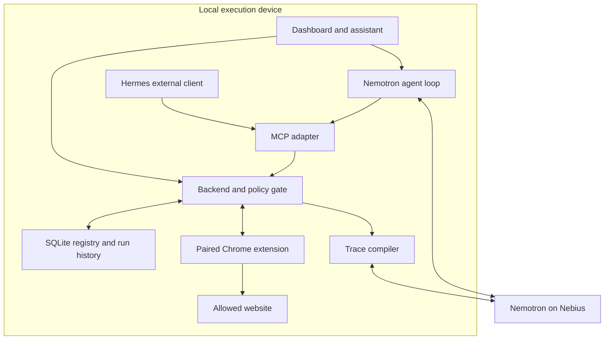
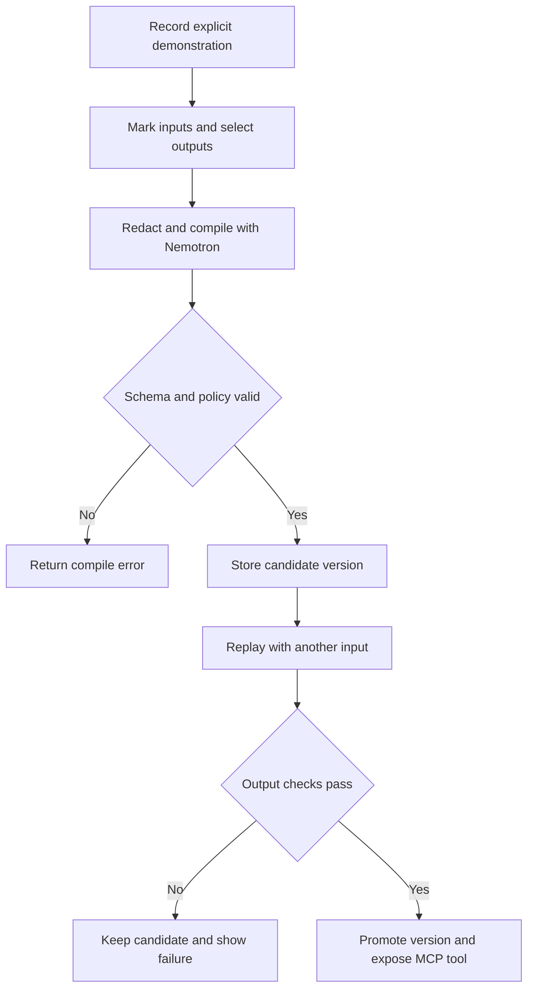
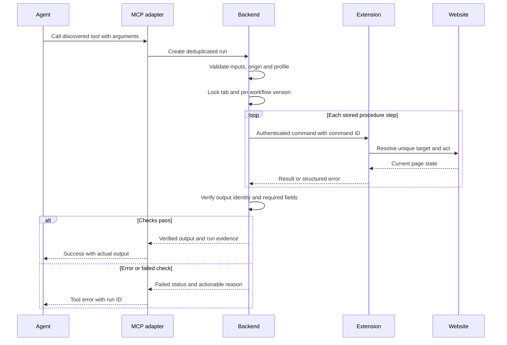
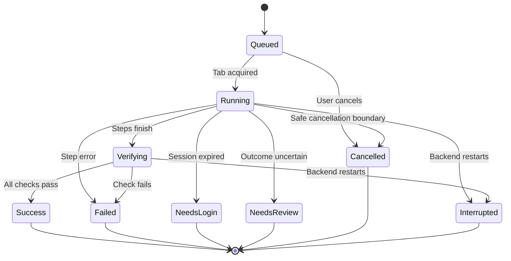

# BrowserSkills architecture

Status: proposed design. See AGENT_BUILD_SPEC.md for the complete implementation contract. None of the integrations below are asserted to be tested by this document.

BrowserSkills turns an explicit browser demonstration into a versioned, verified procedure exposed through MCP. It caches the procedure and fetches fresh results when invoked.

## Component architecture

The backend owns workflow versions, permissions and run state. Both the integrated assistant and Hermes invoke the same MCP tools. The extension executes only a constrained action vocabulary. Website authentication stays in the browser profile.

## Learning and validation

One demonstration supports its observed path. Promotion does not establish support for unobserved branches. The output identity must match the new input, not just be nonempty.

## MCP execution sequence

The protocol is not an exactly-once guarantee for arbitrary websites. If a command outcome is uncertain after disconnect, stop and inspect state. Do not blindly replay a click.

## Run lifecycle

Success is assigned only after verification. An interrupted run requires a new explicit run after state inspection. Status names must be mapped consistently to the API enum implemented by the backend.

## Data and privacy boundaries

| Data | Stored or processed where | Rule |
| --- | --- | --- |
| Website session cookies | Chrome profile | Never export to the model |
| Provider API key | Local backend configuration | Never include in frontend bundles or logs |
| Pairing token | Local backend and extension storage | Authenticate the bridge; never put in a URL |
| Recorded trace | Local temporary storage | Exclude secret inputs and expire raw examples |
| Redacted relevant context | Nebius inference | Explicit cloud boundary; not fully on-device |
| Workflow versions and results | Local SQLite | Keep verification and version evidence |

OpenShell and a compatible NemoClaw blueprint are optional deployment integrations until smoke tested. The real browser remains outside the agent sandbox, so the backend must enforce site and action permissions independently. A sandbox alone does not secure an unrestricted browser bridge.

## Deployment defaults

| Process | Development endpoint | Dependency |
| --- | --- | --- |
| Dashboard | 127.0.0.1:4316 | Proxies authenticated backend requests |
| Backend and extension bridge | 127.0.0.1:4317 | Owns SQLite and paired extension |
| Demo portal | 127.0.0.1:4318 | Seeded local data |
| MCP adapter | stdio child process | Authenticated backend connection |
| Nemotron inference | Configured Nebius endpoint | Selected NVIDIA model and API key |

Production local startup serves built dashboard assets from the backend. Browser tasks require the execution device and browser to remain online. No cloud deployment is implied.

